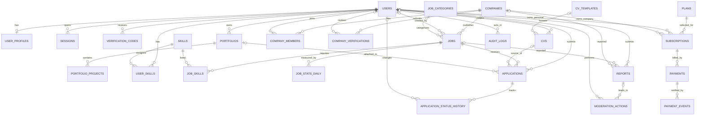

# ByBee Project — ERD Documentation

**Status:** Baseline v1.1 logical model
**Database target:** PostgreSQL
**Last updated:** 28 October 2026
**Related:** `erd-diagrams.md` (per-domain diagrams, SQL for the required changes), `bybee_erd_schema.sql` (draft schema), `../use-case/UseCase.md`

## 1. Purpose

This is the data model the backend is built on. It combines the draft schema (`bybee_erd_schema.sql`) with the changes needed to make the business flows work (registration, applications, packages, verification). The project has no production data, so the changes below should go **directly into the first migrations** rather than into later `ALTER` migrations.

## 2. Tables

### 2.1 Core tables (22, from the draft schema)

| Domain | Tables | Purpose |
|---|---|---|
| Identity | `users`, `user_profiles` | Authentication identity and profile |
| Company | `companies`, `company_members`, `company_verifications` | Company, membership, verification |
| CV and portfolio | `cv_templates`, `cvs`, `portfolios`, `portfolio_projects`, `skills`, `user_skills` | CVs, portfolios, projects, skills |
| Jobs | `job_categories`, `jobs`, `job_skills` | Vacancies, categories, required skills |
| Applications | `applications`, `application_status_history` | Applications and status history |
| Subscriptions | `plans`, `subscriptions`, `payments` | Plans, subscriptions, payment records |
| Governance | `reports`, `moderation_actions`, `audit_logs` | Reports, moderation, audit trail |

### 2.2 New tables required (4)

| Table | Purpose | Why it is needed |
|---|---|---|
| `sessions` | Server-side sessions (token hash, expiry, user agent, IP) | Login, logout, and revocation (see `api.md`) |
| `verification_codes` | One-time codes for email verification and password reset | Registration flow |
| `job_stats_daily` | Daily views and applications per vacancy | Vacancy statistics in the Pro plans |
| `payment_events` | Raw payment webhook payloads, unique per event | Idempotency and audit of payments |

### 2.3 Optional tables (3, separate service line)

`service_packages`, `service_orders`, `project_milestones` support the landing-page service. Create them only if that service is in scope (migration 009).

## 3. Relationship overview

- A user has one profile and may create multiple CVs and portfolios (within plan limits).
- A portfolio contains multiple projects. Users and skills are many-to-many through `user_skills`.
- A user may belong to several companies through `company_members`. A company has several members and may have several verification records.
- A company publishes jobs; a job is created by a member, may belong to one category, and relates to skills through `job_skills`.
- A user submits at most one application per job. An application stores a **CV snapshot**, may reference the original CV and one portfolio, and has status-history records.
- A subscription belongs to **either a user or a company** and refers to one plan. A subscription has payments; a payment has webhook events.
- A report targets a job or a company. A moderation action may reference a report and is performed by an admin. Audit logs record important events.
- A user has sessions and verification codes.

## 4. Conceptual ERD

Notes:

- `|o` marks an optional side. For example, a CV may exist without a template, and an application may lose its original CV but keeps the snapshot.
- The subscription owner is exclusive: exactly one of `user_id` and `company_id` is set (CHECK in the schema).
- `moderation_actions.target_id` is polymorphic and has no foreign key. The backend validates it.

## 5. Integrity and security practices

| Area | Rule |
|---|---|
| Passwords | Store an Argon2id hash only. Never return hashes. |
| Sessions and codes | Store **hashes** of session tokens and verification codes, never the raw value. |
| Keys and constraints | Use foreign keys, the indexes in `erd-diagrams.md` section 10, and transactions for multi-step changes (apply, change status, activate subscription). |
| Ownership | Every query on a CV, portfolio, application, company, or payment filters by owner or membership. |
| Payments | Do not store card data. Store only provider references. Make webhook handling idempotent. |
| Personal data | Retention and deletion follow `UseCase.md` section 6. Hard delete is blocked by `ON DELETE RESTRICT` on applications and payments, so deletion means soft delete plus anonymization. |
| IDs | Keep `BIGINT GENERATED ALWAYS AS IDENTITY` as primary keys. The API returns IDs as **strings** (JavaScript cannot safely hold all 64-bit integers). Public pages use slugs. |
| Timestamps | Use `TIMESTAMPTZ`, stored and returned in UTC (ISO 8601). Convert to local time in the frontend. |
| Money | Use `NUMERIC(14,2)`; return as a decimal string in the API. Currency is `IDR`. |

## 6. Migration mapping

The earlier list ended with `008_create_action_user.sql`, whose name does not match any table group. Replace it with the files below. Each file is run by the migration tool inside its own transaction, so do not write `BEGIN` and `COMMIT` inside it.

| File | Tables |
|---|---|
| `001_create_users.sql` | `users`, `sessions`, `verification_codes` |
| `002_create_profiles.sql` | `user_profiles`, `skills`, `user_skills` |
| `003_create_companies.sql` | `companies`, `company_members`, `company_verifications` |
| `004_create_cv_portfolios.sql` | `cv_templates`, `cvs`, `portfolios`, `portfolio_projects` |
| `005_create_jobs.sql` | `job_categories`, `jobs`, `job_skills`, `job_stats_daily` |
| `006_create_applications.sql` | `applications`, `application_status_history` |
| `007_create_subscriptions.sql` | `plans`, `subscriptions`, `payments`, `payment_events` |
| `008_create_moderation_audit.sql` | `reports`, `moderation_actions`, `audit_logs` |
| `009_create_services.sql` (optional) | `service_packages`, `service_orders`, `project_milestones` |
| `010_seed_master_data.sql` | Seed rows for `plans`, `job_categories`, `cv_templates`, `skills` |

Order follows foreign-key dependencies: `skills` before `job_skills`, `cvs` and `portfolios` before `applications`.

## 7. Decisions (previously open)

| Question | Decision | Status |
|---|---|---|
| User roles and permissions | One `users.role` per account; company permissions from `company_members.member_role` (matrix in `UseCase.md`) | *Confirm* |
| Can a user belong to several companies? | Yes | Decided |
| Profile differences between seekers and recruiters | Same `user_profiles` table. Recruiter-specific data lives in `company_members` (position, role) | Decided |
| CV snapshot for applications | Yes: `applications.cv_snapshot JSONB` | Decided |
| Portfolio on an application | Optional `applications.portfolio_id`, only public or unlisted portfolios | Decided |
| Job statuses | `draft`, `pending_review`, `published`, `closed`, `rejected` (expiry is derived from `expires_at`) | Decided |
| Application statuses | `submitted`, `reviewing`, `shortlisted`, `interview`, `accepted`, `rejected`, `withdrawn`, with the transitions in `UseCase.md` | Decided |
| Subscription renewal, cancellation, refund | Manual renewal; cancellation stops renewal; refund only by admin decision | *Confirm* |
| Quotas | Stored in `plans.features` (`RancanganPaket.md`) and enforced by the backend | Decided |
| Verification and moderation states | As in the schema `CHECK` lists | Decided |
| Deletion and retention | Soft delete plus anonymization; periods in `UseCase.md` section 6 | *Confirm with legal advice* |
| ID strategy | `BIGINT` identity, strings in the API, slugs for public pages | Decided |

## 8. Required schema changes

Full SQL is in `erd-diagrams.md` section 10. Priority: 🔴 before the first migration, 🟡 before release, 🟢 when needed.

| # | Prio | Change | Needed by |
|---|:-:|---|---|
| S1 | 🔴 | `users.email` case-insensitive (`CITEXT`); add `phone_e164` (unique), `phone_verified_at` | Registration, login |
| S2 | 🔴 | Tables `sessions`, `verification_codes` | Authentication |
| S3 | 🔴 | `applications.cv_snapshot` (JSONB) and `applications.portfolio_id` | Apply flow |
| S4 | 🔴 | `jobs.expires_at`, `jobs.priority_score`, `jobs.view_count` | Listing days, priority, statistics |
| S5 | 🔴 | `companies.verified_at`, `companies.slug` | Verification gate, public page |
| S6 | 🔴 | Seed `plans` (6 rows) from `RancanganPaket.md` | Packages |
| S7 | 🟡 | `cv_templates.access_tier` (`basic`, `premium`, `premium_plus`) replaces `is_premium` | Template tiers per plan |
| S8 | 🟡 | `job_stats_daily` | Vacancy statistics |
| S9 | 🟡 | Partial unique index: one `active` subscription per user or company | Subscription rule |
| S10 | 🟡 | `payment_events` | Webhook idempotency |
| S11 | 🟡 | Indexes, `updated_at` triggers, `portfolios.slug` required when not private | Performance, integrity |
| S12 | 🟡 | `user_profiles.is_discoverable` | Candidate search (Phase 3) |
| S13 | 🟢 | Align `reports` targets with `moderation_actions` (`user`, `portfolio`) | Consistency |
| S14 | 🟢 | Structured `jobs.province` and `jobs.city` | Accurate location filter |
| S15 | 🟢 | Normalized CV tables (`cv_education`, `cv_experience`) | Filtering by education or experience |
