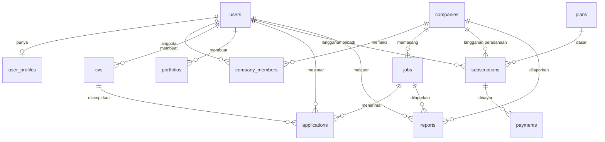
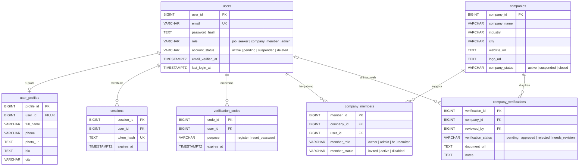
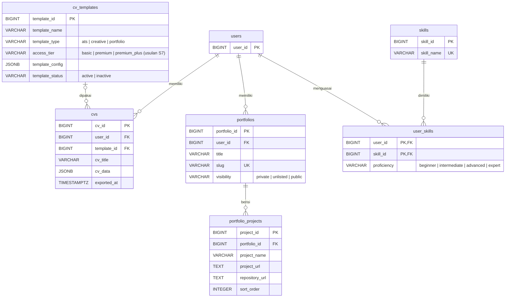
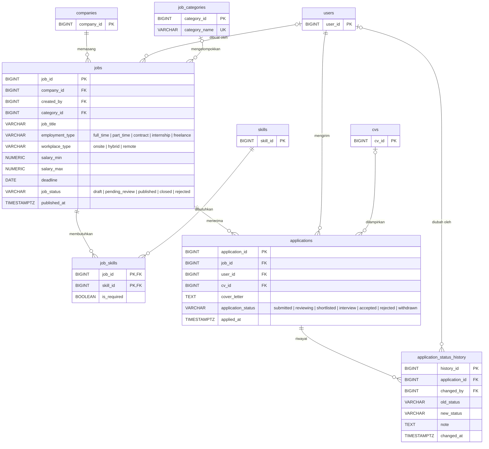
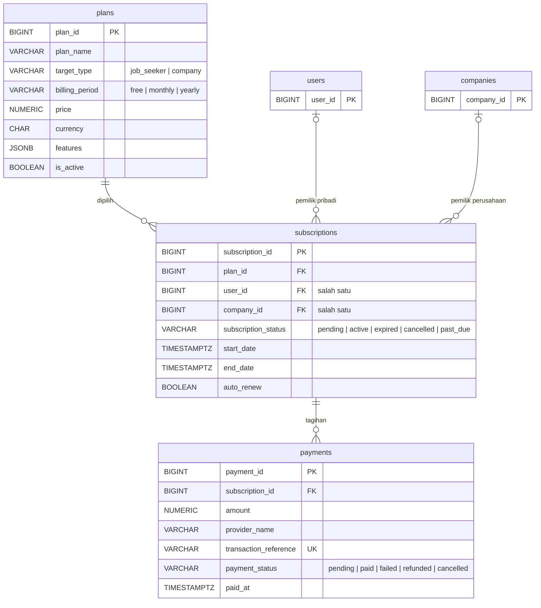
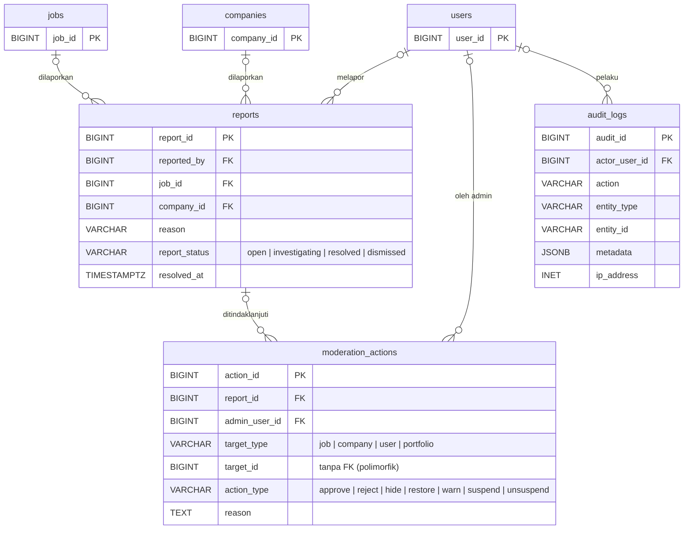
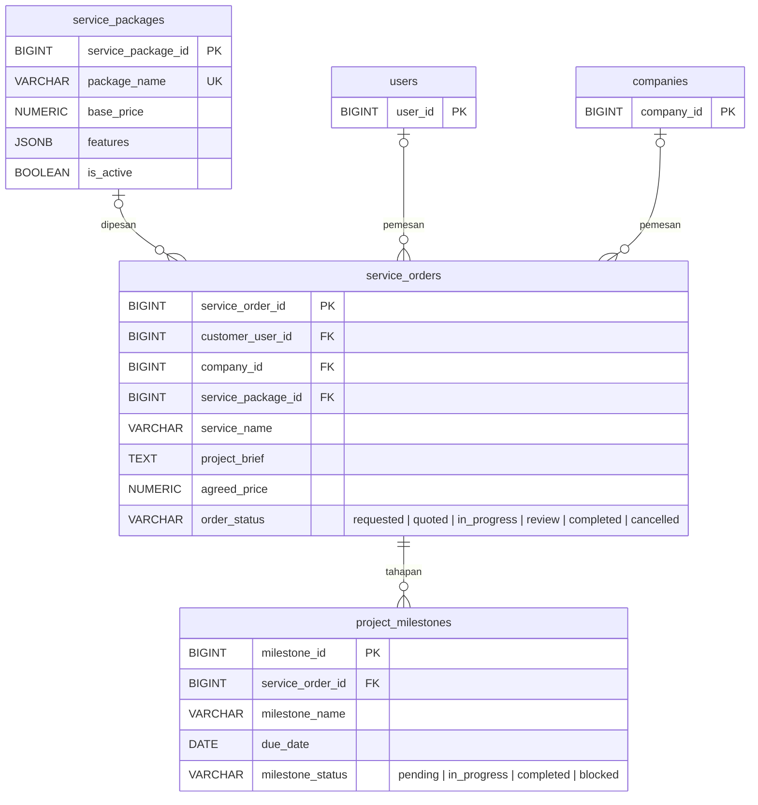

# ByBee Career — Entity Relationship Diagram (ERD)

> Sumber: `bybee_erd_schema.sql` (PostgreSQL, 25 tabel) ditambah 4 tabel baru. Dokumen pendamping [`Erd.md`](./Erd.md) (keputusan dan aturan). Tabel baru (`sessions`, `verification_codes`, `job_stats_daily`, `payment_events`) dan kolom baru ditulis di bagian 10, belum tampil di diagram per domain di bawah.
> Diagram hanya menampilkan **kolom kunci** (PK, FK, kolom penting) agar tetap terbaca. Daftar kolom lengkap ada di file SQL.
> Plan awal menyebut dua ERD (*ERD User* dan *ERD HRD / Perwakilan Perusahaan*). Dokumen ini membaginya menjadi enam domain.

## Daftar Isi

1. [Gambaran umum](#1-gambaran-umum)
2. [Domain 1 — Identitas & Perusahaan](#2-domain-1--identitas--perusahaan-erd-user--erd-perusahaan)
3. [Domain 2 — CV, Portofolio & Skill](#3-domain-2--cv-portofolio--skill)
4. [Domain 3 — Lowongan & Lamaran](#4-domain-3--lowongan--lamaran)
5. [Domain 4 — Langganan & Pembayaran](#5-domain-4--langganan--pembayaran)
6. [Domain 5 — Moderasi & Audit](#6-domain-5--moderasi--audit)
7. [Domain 6 — Jasa Layanan (opsional)](#7-domain-6--jasa-layanan-opsional)
8. [Pemetaan tabel ke file migrasi](#8-pemetaan-tabel-ke-file-migrasi)
9. [Aturan data dan constraint penting](#9-aturan-data-dan-constraint-penting)
10. [Rekomendasi perubahan schema](#10-rekomendasi-perubahan-schema)

---

## 1. Gambaran Umum

Diagram ini hanya memperlihatkan relasi antar domain. Detail tiap domain ada di bagian berikutnya.



| Domain | Tabel |
|---|---|
| Identitas & Perusahaan | `users`, `user_profiles`, `companies`, `company_members`, `company_verifications` |
| CV, Portofolio & Skill | `cv_templates`, `cvs`, `portfolios`, `portfolio_projects`, `skills`, `user_skills` |
| Lowongan & Lamaran | `job_categories`, `jobs`, `job_skills`, `applications`, `application_status_history` |
| Langganan & Pembayaran | `plans`, `subscriptions`, `payments` |
| Moderasi & Audit | `reports`, `moderation_actions`, `audit_logs` |
| Jasa Layanan (opsional) | `service_packages`, `service_orders`, `project_milestones` |

---

## 2. Domain 1 — Identitas & Perusahaan (ERD User + ERD Perusahaan)



**Catatan**

- `company_members` berkedudukan sebagai tabel penghubung many-to-many antara `users` dan `companies`, dengan `UNIQUE (company_id, user_id)`. Satu pengguna bisa tergabung di beberapa perusahaan, dan satu perusahaan punya banyak anggota.
- `users.role = company_member` menandai jenis akun; **hak di dalam perusahaan** ditentukan oleh `company_members.member_role`.
- `company_verifications` menyimpan riwayat pengajuan, jadi satu perusahaan bisa punya banyak baris (misalnya ditolak lalu mengajukan ulang).

---

## 3. Domain 2 — CV, Portofolio & Skill



**Catatan**

- Isi CV (pengalaman, pendidikan, dll.) disimpan di kolom JSONB `cvs.cv_data`. Ini cepat untuk MVP, tetapi data tersebut tidak bisa difilter secara efisien. Jika nanti perlu mencari kandidat berdasarkan pendidikan atau pengalaman, pindahkan ke tabel terpisah (sudah tertulis di komentar akhir file SQL).
- Level template ditandai `cv_templates.access_tier` (usulan S7, menggantikan `is_premium`); aturan siapa boleh memakainya ditegakkan di backend berdasarkan `plans.features.template_tiers`.
- `portfolios.slug` bernilai unik dan dipakai untuk URL publik. Karena nullable, portofolio `public` sebaiknya selalu diberi slug (lihat rekomendasi).
- `user_skills` adalah tabel penghubung dengan primary key gabungan `(user_id, skill_id)`.

---

## 4. Domain 3 — Lowongan & Lamaran



**Catatan**

- `applications` memiliki `UNIQUE (job_id, user_id)`: satu pengguna hanya bisa melamar sekali per loker.
- `jobs` memakai `ON DELETE RESTRICT` ke `companies`, sehingga perusahaan yang masih punya loker tidak bisa dihapus (gunakan `company_status = 'closed'`).
- `applications.cv_id` bernilai `ON DELETE SET NULL`. Artinya jika pelamar menghapus CV, HRD kehilangan CV yang dulu dikirim. Lihat rekomendasi snapshot CV.
- Kontrol `salary_max >= salary_min` sudah ada lewat CHECK.

---

## 5. Domain 4 — Langganan & Pembayaran



**Catatan**

- Pemilik langganan bersifat **eksklusif**: tepat satu dari `user_id` atau `company_id` terisi (CHECK pada `subscriptions`).
- `plans.features` (JSONB) menyimpan batas dan hak paket, misalnya:

```json
{
  "max_active_jobs": null,
  "job_listing_days": 150,
  "advanced_candidate_filter": true,
  "priority_listing": true,
  "premium_badge": true
}
```

```json
{
  "remove_watermark": true,
  "premium_templates": true,
  "max_cvs": 10
}
```

- Paket gratis tetap dicatat sebagai baris `plans` (`billing_period = 'free'`, `price = 0`) sehingga logika batas paket seragam.

---

## 6. Domain 5 — Moderasi & Audit



**Catatan**

- `moderation_actions.target_id` bersifat polimorfik (tergantung `target_type`), sehingga tidak ada foreign key dan konsistensinya dijaga oleh backend.
- `reports` hanya bisa menunjuk `job` atau `company`, padahal `moderation_actions` juga mengenal `user` dan `portfolio`. Pertimbangkan menyamakan keduanya.

---

## 7. Domain 6 — Jasa Layanan (opsional)

Modul ini hanya diaktifkan jika layanan landing page dimasukkan ke lingkup (fase 4).



---

## 8. Pemetaan Tabel ke File Migrasi

Pemetaan final (25 tabel dari schema ditambah 4 tabel baru) ada di [`Erd.md`](./Erd.md) bagian 6. Ringkasnya: `001` users + `sessions` + `verification_codes`, `002` profil dan skill, `003` perusahaan, `004` CV dan portofolio, `005` loker + `job_stats_daily`, `006` lamaran, `007` langganan + `payment_events`, `008_create_moderation_audit.sql`, `009` jasa layanan (opsional), `010` seed data master.

---

## 9. Aturan Data dan Constraint Penting

| Tabel | Aturan | Mekanisme |
|---|---|---|
| `users` | Email unik | `UNIQUE` (lihat rekomendasi: tidak sensitif huruf besar/kecil) |
| `user_profiles` | Satu profil per pengguna | `user_id UNIQUE` |
| `company_members` | Satu pengguna sekali per perusahaan | `UNIQUE (company_id, user_id)` |
| `portfolio_projects` | `end_date >= start_date` | `CHECK` |
| `jobs` | `salary_max >= salary_min`, nilai gaji tidak negatif | `CHECK` |
| `applications` | Satu lamaran per pengguna per loker | `UNIQUE (job_id, user_id)` |
| `plans` | Kombinasi nama, target, periode unik | `UNIQUE (plan_name, target_type, billing_period)` |
| `subscriptions` | Pemilik pengguna **atau** perusahaan | `CHECK` eksklusif |
| `payments` | Referensi transaksi unik (idempotensi webhook) | `UNIQUE (transaction_reference)` |
| `reports` | Minimal menunjuk loker atau perusahaan | `CHECK` |
| `service_orders` | Minimal punya pemesan | `CHECK` |

**Perilaku penghapusan (ON DELETE)**

| Perilaku | Dipakai pada | Alasan |
|---|---|---|
| `CASCADE` | profil, CV, portofolio, proyek, anggota perusahaan, skill | Data turunan ikut hilang bersama induknya |
| `RESTRICT` | `jobs → companies`, `applications → jobs/users`, `subscriptions`, `payments` | Data transaksi dan lamaran tidak boleh hilang tanpa sengaja |
| `SET NULL` | `created_by`, `reviewed_by`, `changed_by`, `cv_id`, `template_id` | Data tetap ada walau pelaku/rujukannya dihapus |

> Konsekuensi: pengguna yang pernah melamar atau berlangganan **tidak bisa dihapus permanen** (`RESTRICT`). Gunakan `account_status = 'deleted'` ditambah proses *anonimisasi* data pribadi untuk memenuhi permintaan hapus data.

---

## 10. Perubahan Schema yang Diperlukan

Daftar bernomor S1–S15 sama dengan `Erd.md` bagian 8. Prioritas: 🔴 sebelum migrasi pertama, 🟡 sebelum rilis, 🟢 bila diperlukan.

| # | Prio | Perubahan | Alasan |
|---|:-:|---|---|
| S1 | 🔴 | `users.email` menjadi `CITEXT`; tambah `phone_e164` (unik) dan `phone_verified_at` | `Budi@x.com` dan `budi@x.com` tidak boleh jadi dua akun; nomor WA muncul di flowchart tetapi belum punya kolom |
| S2 | 🔴 | Tabel `sessions` dan `verification_codes` | Login, logout, verifikasi email, reset password |
| S3 | 🔴 | `applications.cv_snapshot` dan `applications.portfolio_id` | HRD melihat CV persis seperti saat dikirim; portofolio ikut terlampir |
| S4 | 🔴 | `jobs.expires_at`, `jobs.priority_score`, `jobs.view_count` | Masa tayang 30/60/150 hari, prioritas penayangan, statistik dasar |
| S5 | 🔴 | `companies.verified_at`, `companies.slug` | Gerbang verifikasi sebelum posting; halaman publik perusahaan |
| S6 | 🔴 | Seed 6 baris `plans` dari `RancanganPaket.md` | Paket Free dan Pro |
| S7 | 🟡 | `cv_templates.access_tier` menggantikan `is_premium` | Level template per paket (terpilih vs semua) |
| S8 | 🟡 | Tabel `job_stats_daily` | Statistik terbatas dan lengkap |
| S9 | 🟡 | *Partial unique index* satu langganan `active` per pemilik | Mencegah langganan ganda |
| S10 | 🟡 | Tabel `payment_events` | Idempotensi dan audit webhook |
| S11 | 🟡 | Indeks tambahan, trigger `updated_at`, `CHECK` slug portofolio | Performa dan integritas |
| S12 | 🟡 | `user_profiles.is_discoverable` | Opt-in pencarian kandidat (fase 3) |
| S13 | 🟢 | Samakan target `reports` dengan `moderation_actions` | Konsistensi |
| S14 | 🟢 | `jobs.province`, `jobs.city` terstruktur | Filter lokasi akurat |
| S15 | 🟢 | Normalisasi CV (`cv_education`, `cv_experience`) | Filter berdasarkan pendidikan/pengalaman |

### Contoh SQL (S1 sampai S5, S7 sampai S12)

```sql
-- S1: email tidak sensitif huruf, nomor telepon
CREATE EXTENSION IF NOT EXISTS citext;
ALTER TABLE users
  ALTER COLUMN email TYPE CITEXT,
  ADD COLUMN phone_e164 VARCHAR(20) UNIQUE,
  ADD COLUMN phone_verified_at TIMESTAMPTZ;

-- S2: sesi dan kode verifikasi (simpan hash, bukan nilai asli)
CREATE TABLE sessions (
  session_id   BIGINT GENERATED ALWAYS AS IDENTITY PRIMARY KEY,
  user_id      BIGINT NOT NULL REFERENCES users(user_id) ON DELETE CASCADE,
  token_hash   TEXT NOT NULL UNIQUE,
  user_agent   TEXT,
  ip_address   INET,
  expires_at   TIMESTAMPTZ NOT NULL,
  last_seen_at TIMESTAMPTZ NOT NULL DEFAULT CURRENT_TIMESTAMP,
  revoked_at   TIMESTAMPTZ,
  created_at   TIMESTAMPTZ NOT NULL DEFAULT CURRENT_TIMESTAMP
);
CREATE INDEX idx_sessions_user_id ON sessions(user_id);

CREATE TABLE verification_codes (
  code_id      BIGINT GENERATED ALWAYS AS IDENTITY PRIMARY KEY,
  user_id      BIGINT NOT NULL REFERENCES users(user_id) ON DELETE CASCADE,
  channel      VARCHAR(10) NOT NULL CHECK (channel IN ('email','whatsapp')),
  purpose      VARCHAR(20) NOT NULL CHECK (purpose IN ('register','reset_password')),
  code_hash    TEXT NOT NULL,
  attempts     SMALLINT NOT NULL DEFAULT 0,
  expires_at   TIMESTAMPTZ NOT NULL,
  consumed_at  TIMESTAMPTZ,
  created_at   TIMESTAMPTZ NOT NULL DEFAULT CURRENT_TIMESTAMP
);
CREATE INDEX idx_verification_codes_user ON verification_codes(user_id, purpose);

-- S3: snapshot CV dan portofolio pada lamaran
ALTER TABLE applications
  ADD COLUMN cv_snapshot  JSONB NOT NULL DEFAULT '{}'::jsonb,
  ADD COLUMN portfolio_id BIGINT REFERENCES portfolios(portfolio_id) ON DELETE SET NULL;

-- S4: masa tayang, prioritas, tayangan
ALTER TABLE jobs
  ADD COLUMN expires_at     TIMESTAMPTZ,
  ADD COLUMN priority_score SMALLINT NOT NULL DEFAULT 0,
  ADD COLUMN view_count     INTEGER  NOT NULL DEFAULT 0;
CREATE INDEX idx_jobs_listing ON jobs(job_status, priority_score DESC, published_at DESC);

-- S5: verifikasi dan slug perusahaan
ALTER TABLE companies
  ADD COLUMN verified_at TIMESTAMPTZ,
  ADD COLUMN slug VARCHAR(180) UNIQUE;

-- S7: level template (menggantikan is_premium)
ALTER TABLE cv_templates
  ADD COLUMN access_tier VARCHAR(20) NOT NULL DEFAULT 'basic'
    CHECK (access_tier IN ('basic','premium','premium_plus')),
  DROP COLUMN is_premium;

-- S8: statistik harian per lowongan
CREATE TABLE job_stats_daily (
  job_id       BIGINT NOT NULL REFERENCES jobs(job_id) ON DELETE CASCADE,
  stat_date    DATE   NOT NULL,
  views        INTEGER NOT NULL DEFAULT 0,
  applications INTEGER NOT NULL DEFAULT 0,
  PRIMARY KEY (job_id, stat_date)
);

-- S9: satu langganan aktif per pemilik
CREATE UNIQUE INDEX uq_active_sub_user
  ON subscriptions(user_id) WHERE subscription_status = 'active' AND user_id IS NOT NULL;
CREATE UNIQUE INDEX uq_active_sub_company
  ON subscriptions(company_id) WHERE subscription_status = 'active' AND company_id IS NOT NULL;

-- S10: log webhook pembayaran
CREATE TABLE payment_events (
  event_id     BIGINT GENERATED ALWAYS AS IDENTITY PRIMARY KEY,
  payment_id   BIGINT REFERENCES payments(payment_id) ON DELETE SET NULL,
  provider_name VARCHAR(80) NOT NULL,
  provider_event_id VARCHAR(200) NOT NULL,
  payload      JSONB NOT NULL,
  received_at  TIMESTAMPTZ NOT NULL DEFAULT CURRENT_TIMESTAMP,
  UNIQUE (provider_name, provider_event_id)
);

-- S11 (sebagian): slug wajib bila portofolio tidak private; indeks pencarian dan antrean admin
ALTER TABLE portfolios
  ADD CONSTRAINT chk_portfolio_slug CHECK (visibility = 'private' OR slug IS NOT NULL);
CREATE INDEX idx_user_skills_skill ON user_skills(skill_id);
CREATE INDEX idx_job_skills_skill  ON job_skills(skill_id);
CREATE INDEX idx_company_members_user ON company_members(user_id);
CREATE INDEX idx_reports_status ON reports(report_status);
CREATE INDEX idx_moderation_target ON moderation_actions(target_type, target_id);
CREATE EXTENSION IF NOT EXISTS pg_trgm;
CREATE INDEX idx_jobs_title_trgm ON jobs USING gin (job_title gin_trgm_ops);

-- S12: opt-in pencarian kandidat (fase 3)
ALTER TABLE user_profiles
  ADD COLUMN is_discoverable BOOLEAN NOT NULL DEFAULT FALSE;
```

> Karena project masih di tahap perencanaan, perubahan di atas sebaiknya **langsung ditulis di file migrasi awal**, bukan sebagai migrasi `ALTER` terpisah. Setelah ada data produksi, ubah schema hanya lewat migrasi baru.
