# ByBee Project — Use Case & Alur Sistem

> Dokumen pendamping [`UseCase.md`](./UseCase.md) (keputusan, ID use case, aturan akses). Dokumen ini menyempurnakan bagian *Desain Sistem* di plan awal. Semua diagram memakai [Mermaid](https://mermaid.js.org/) dan tampil otomatis di GitHub/GitLab.
> Nama tabel dan status mengacu ke `backend/migrations` dan `docs/erd/erd.md`.

---

## 1. Aktor

Plan awal memiliki tiga aktor. Setelah dicocokkan dengan schema database, daftarnya menjadi:

| Aktor | Role di database | Keterangan |
|---|---|---|
| **Tamu (Guest)** | — | Pengunjung belum login. Dapat melihat loker publik, portofolio publik, dan halaman landing |
| **Pencari Kerja** (*Pengguna* di plan awal) | `users.role = job_seeker` | Membuat CV, portofolio, melamar loker, berlangganan Pro |
| **Anggota Perusahaan** (*HRD / Perwakilan Perusahaan* di plan awal) | `users.role = company_member` + `company_members.member_role` (`owner`, `admin`, `hr`, `recruiter`) | Mengelola profil perusahaan, memasang loker, mengelola pelamar |
| **Admin ByBee** | `users.role = admin` | Verifikasi perusahaan, moderasi loker dan report, kelola paket |
| **Payment Gateway** (sistem eksternal) | — | Memproses pembayaran dan mengirim webhook |
| **Penyedia Email / WhatsApp** (sistem eksternal) | — | Mengirim kode verifikasi dan notifikasi |

**Perubahan dari plan awal**

- Tugas admin di plan awal hanya *maintenance website dan database*. Itu pekerjaan operasional/DevOps, bukan use case aplikasi. Peran admin di aplikasi adalah **verifikasi, moderasi, dan manajemen paket**.
- Aktor **Tamu** ditambahkan karena sebagian fitur (lihat loker, lihat portofolio publik) tidak memerlukan login.
- Use case "Free and Pro" digabung ke satu use case; perbedaan Free/Pro diatur oleh **aturan paket** (lihat bagian 5), bukan use case terpisah.

---

## 2. Diagram Use Case

Mermaid tidak punya diagram use case native, jadi diagram di bawah memakai flowchart dengan aktor di sisi kiri/kanan.

### 2.1 Gambaran Umum

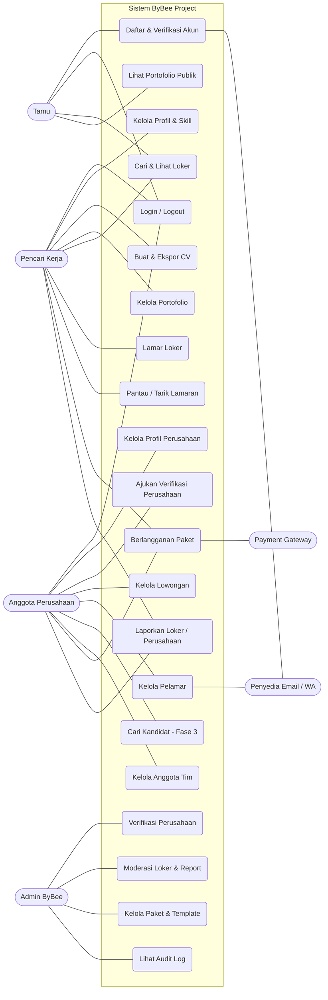

### 2.2 Relasi antar use case

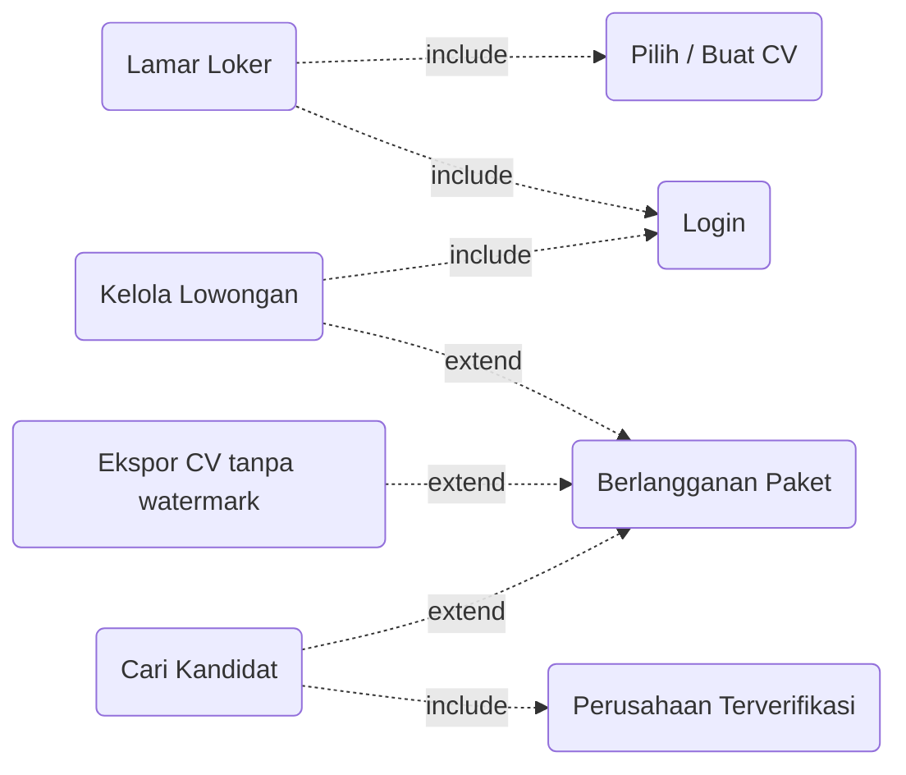

> `include` = selalu dijalankan sebagai bagian dari use case. `extend` = hanya terjadi bila kondisi terpenuhi (misalnya batas paket Free terlampaui).

---

## 3. Katalog Use Case

Katalog use case (ID UC-01 sampai UC-28), fase, dan catatan keputusan ada di [`UseCase.md`](./UseCase.md). File ini hanya berisi **diagram dan flowchart**, jadi tidak ada daftar ID ganda di sini.

---

## 4. Alur Utama (Flowchart)

### 4.1 Registrasi dan Login

Flowchart di plan awal sudah menggambarkan registrasi dengan nama, email, nomor WhatsApp, dan password, serta login dengan email atau nomor WhatsApp. Versi di bawah mempertahankan alur itu dengan perbaikan berikut:

- Pilihan **tipe akun** (pencari kerja atau perusahaan) saat registrasi. Plan awal belum punya flowchart registrasi perusahaan.
- Akun baru dibuat berstatus `pending` dan menjadi `active` setelah verifikasi (konsisten dengan `account_status`).
- Login memakai **email** pada MVP; login dengan nomor WA menunggu verifikasi nomor (fase lanjut).
- Pesan error login **tidak membocorkan** apakah email terdaftar ("Email belum terdaftar" memudahkan penyerang menebak akun).
- Ada **batas percobaan** (rate limit) dan **kirim ulang kode**.
- Ada alur **lupa password**.

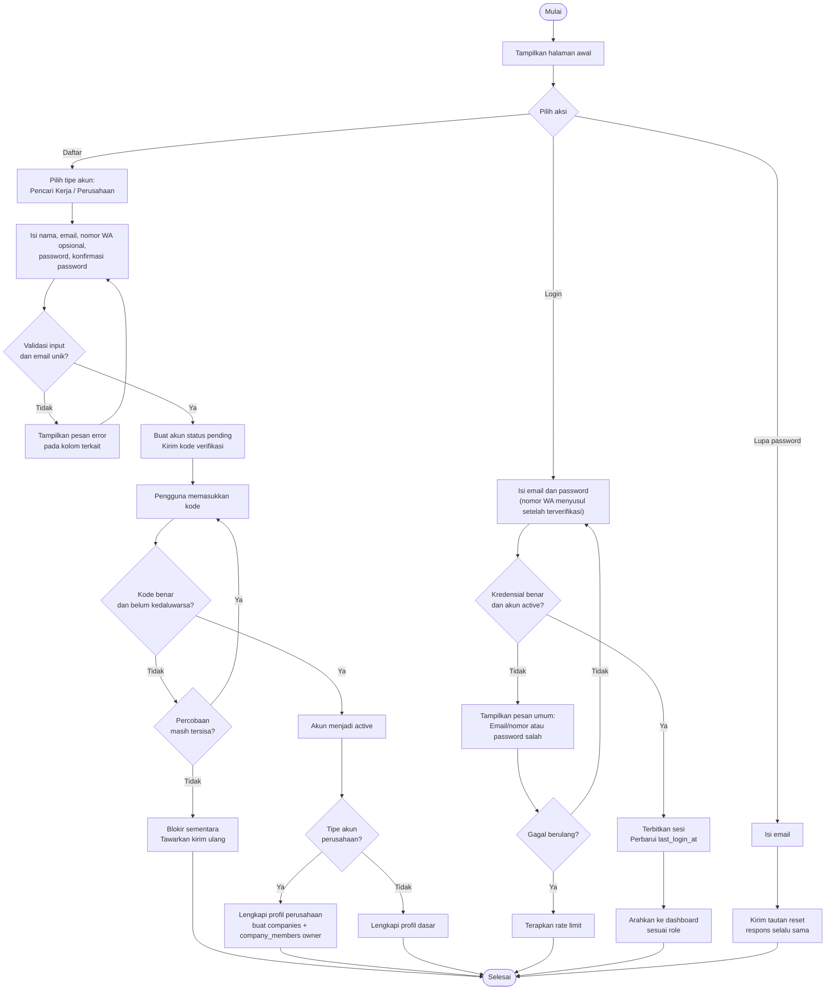

### 4.2 Membuat CV dan Portofolio

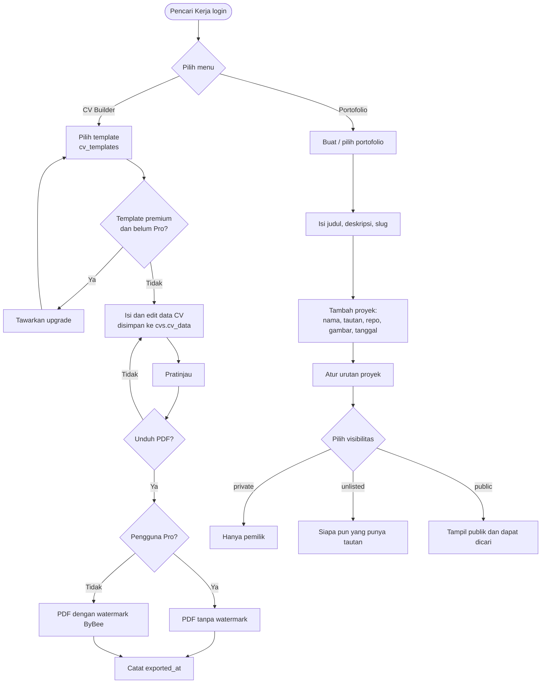

### 4.3 Mencari dan Melamar Loker

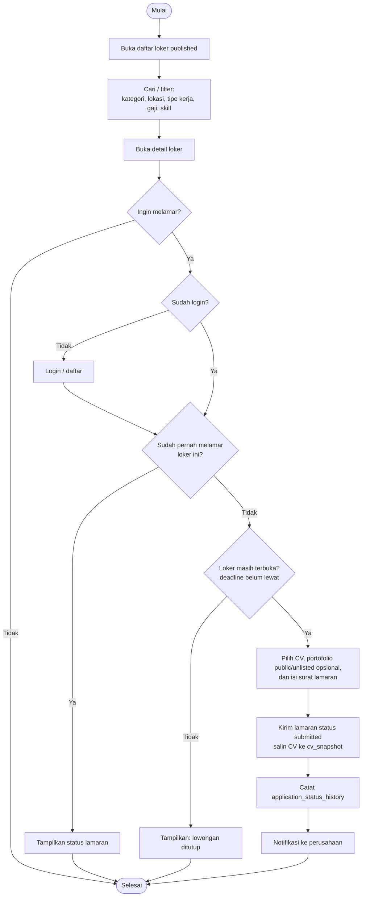

### 4.4 Memasang Lowongan (Perusahaan)

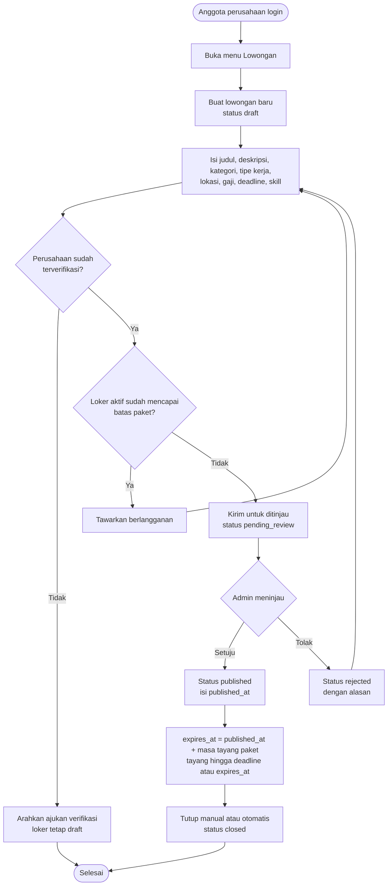

### 4.5 Mengelola Pelamar dan Mencari Kandidat

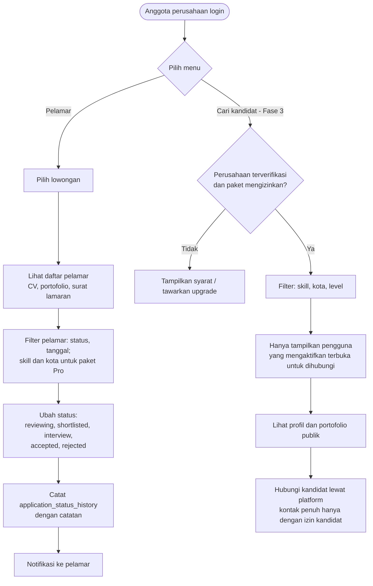

### 4.6 Langganan dan Pembayaran

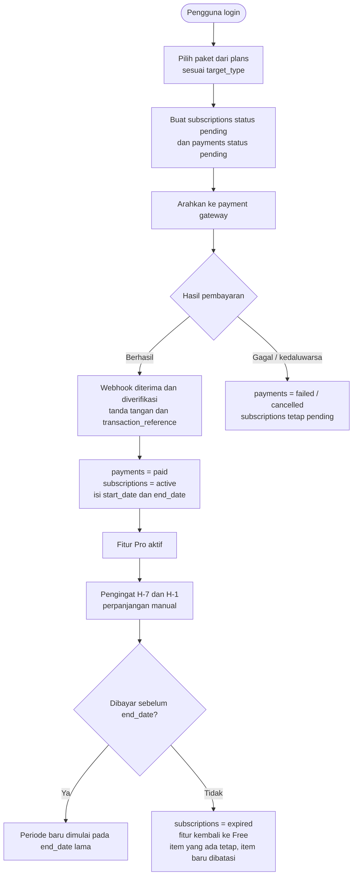

### 4.7 Verifikasi Perusahaan dan Moderasi (Admin)

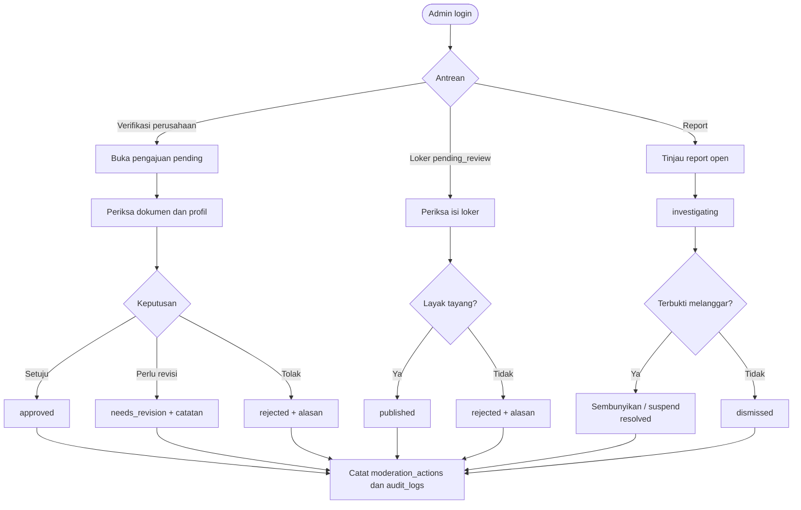

---

## 5. Status dan Aturan Bisnis

### 5.1 Status lamaran (`applications.application_status`)

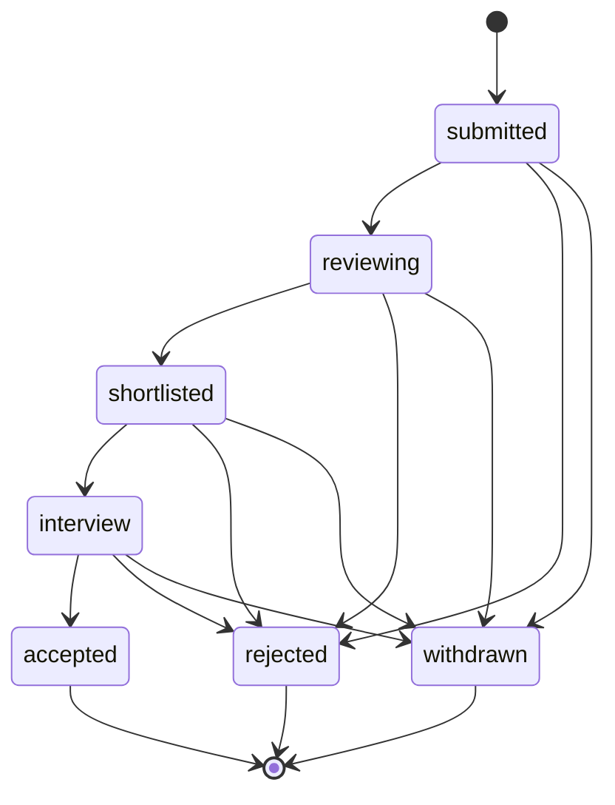

### 5.2 Status lowongan (`jobs.job_status`)

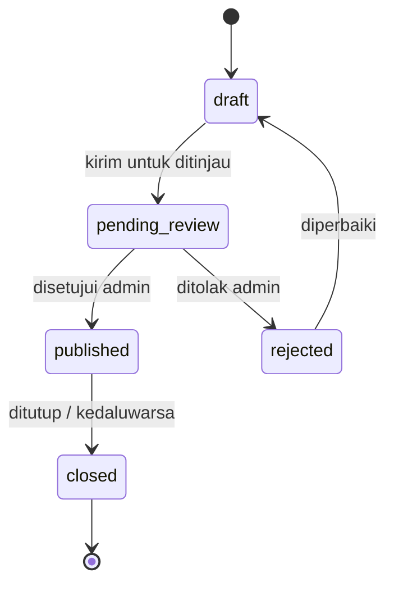

### 5.3 Status langganan (`subscriptions.subscription_status`)

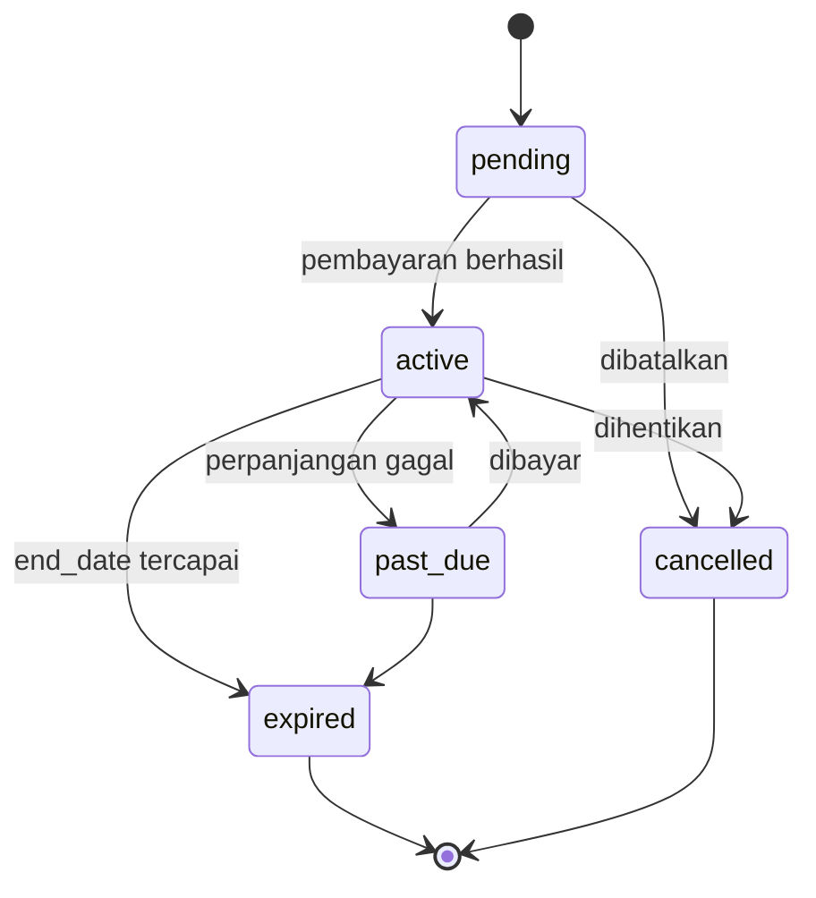

### 5.4 Aturan bisnis utama

| Kode | Aturan | Ditegakkan di |
|---|---|---|
| BR-01 | Satu pengguna hanya boleh melamar satu kali per loker | Database (`UNIQUE (job_id, user_id)`) |
| BR-02 | Hanya loker `published` yang tampil ke publik | Backend (query) |
| BR-03 | Lamaran hanya diterima sebelum `deadline` dan saat loker `published` | Backend |
| BR-04 | Satu langganan milik **satu** pengguna **atau** satu perusahaan | Database (CHECK pada `subscriptions`) |
| BR-05 | Paket harus cocok dengan target (`plans.target_type`) | Backend |
| BR-06 | Satu pemilik hanya boleh punya satu langganan `active` per target | Disarankan: *partial unique index* |
| BR-07 | Template `is_premium` hanya bisa dipakai pengguna Pro | Backend |
| BR-08 | CV gratis diekspor dengan watermark | Backend (PDF) |
| BR-09 | Hanya anggota perusahaan dengan role sesuai yang dapat mengelola loker/pelamar | Backend (middleware peran) |
| BR-10 | Loker hanya bisa dikirim untuk ditinjau bila perusahaan terverifikasi, dan hanya tayang setelah disetujui admin | Backend (`pending_review`) |
| BR-11 | Perubahan status lamaran selalu dicatat di `application_status_history` | Backend (transaksi) |
| BR-12 | Kandidat hanya muncul di pencarian jika mengaktifkan opt-in (fase 3) | Kolom `user_profiles.is_discoverable` (S12 di `Erd.md`) |
| BR-13 | Masa tayang loker: Free 30 hari, Pro Bulanan 60 hari, Pro Tahunan 150 hari | Backend + `plans.features.job_listing_days` |
| BR-14 | Tindakan admin dicatat di `moderation_actions` dan `audit_logs` | Backend |

### 5.5 Matriks hak akses

| Fitur | Tamu | Pencari Kerja | Anggota Perusahaan | Admin |
|---|:-:|:-:|:-:|:-:|
| Lihat loker published | ✅ | ✅ | ✅ | ✅ |
| Lihat portofolio public / unlisted | ✅ | ✅ | ✅ | ✅ |
| Kelola CV dan portofolio sendiri | — | ✅ | — | — |
| Melamar loker | — | ✅ | — | — |
| Kelola profil perusahaan | — | — | ✅ (owner/admin) | — |
| Posting dan edit loker | — | — | ✅ (owner/admin/hr/recruiter) | — |
| Kelola pelamar | — | — | ✅ | — |
| Cari kandidat | — | — | ✅ (terverifikasi + paket) | — |
| Kelola anggota tim | — | — | ✅ (owner/admin) | — |
| Berlangganan | — | ✅ | ✅ | — |
| Verifikasi perusahaan, moderasi, audit log | — | — | — | ✅ |
| Kelola paket, template, kategori | — | — | — | ✅ |

---

## 6. Catatan Perbaikan dari Plan Awal

1. Flowchart plan awal untuk **HRD/perwakilan perusahaan**, **menu portofolio**, **menu info loker**, **posting job**, dan **menu kandidat** masih berupa judul tanpa gambar. Bagian 4.2 sampai 4.5 mengisi kekosongan itu.
2. Use case plan awal menggabungkan "Upload Portofolio and Find Job". Di sini dipisah karena aktornya, prasyarat, dan tabelnya berbeda.
3. Use case yang belum ada di plan awal tetapi dibutuhkan schema: **lamar loker, pantau lamaran, langganan, verifikasi perusahaan, laporan, moderasi, kelola anggota tim**.
4. Nomor WhatsApp muncul di flowchart registrasi, tetapi **belum ada kolomnya di tabel `users`** (hanya `user_profiles.phone`). Pada MVP nomor bersifat opsional dan belum dipakai untuk login; lihat S1 di `docs/erd/Erd.md`.
